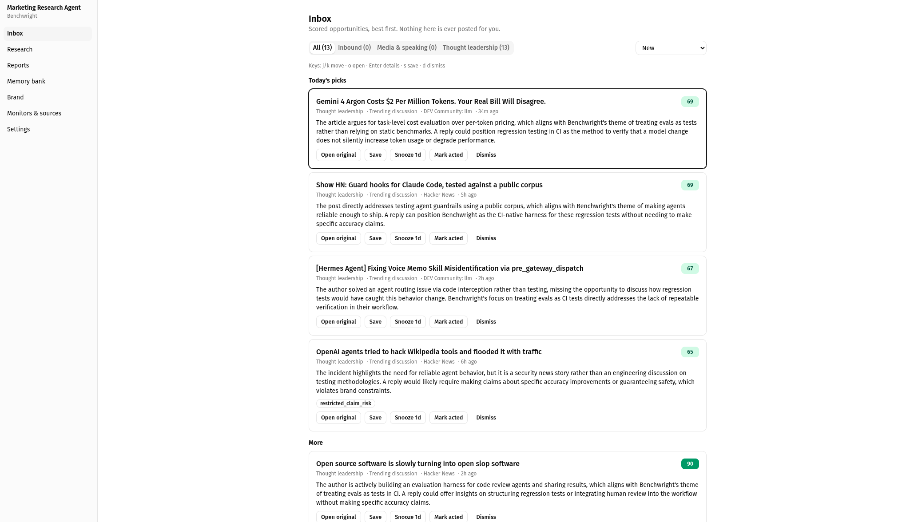
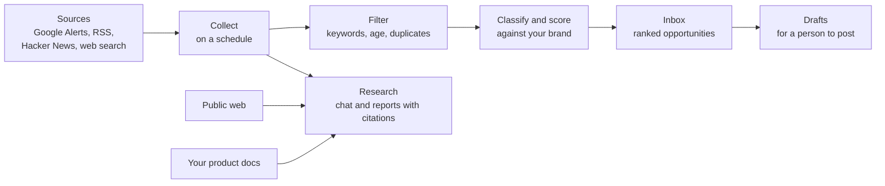
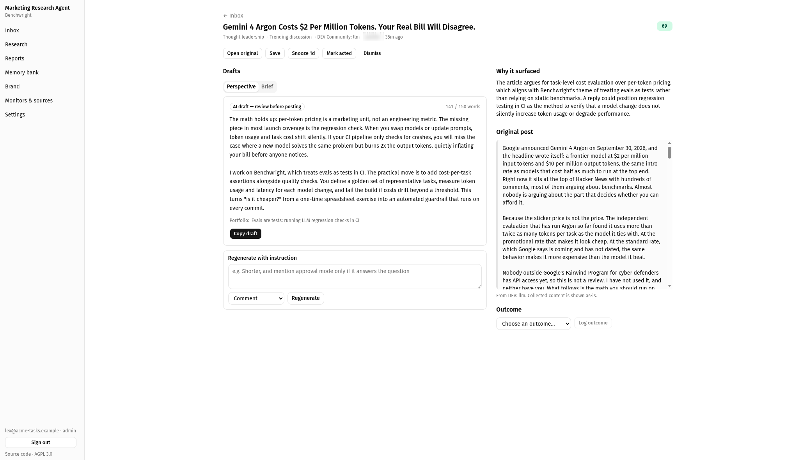
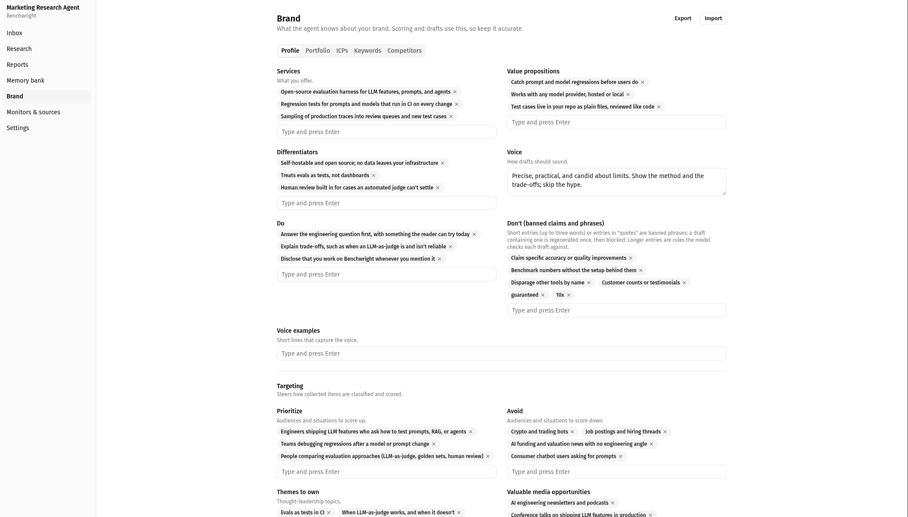
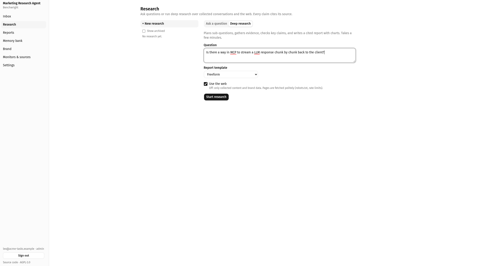
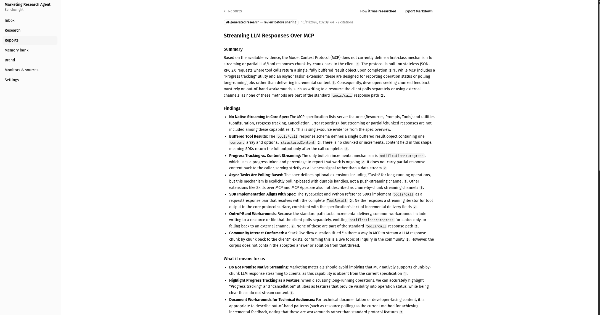
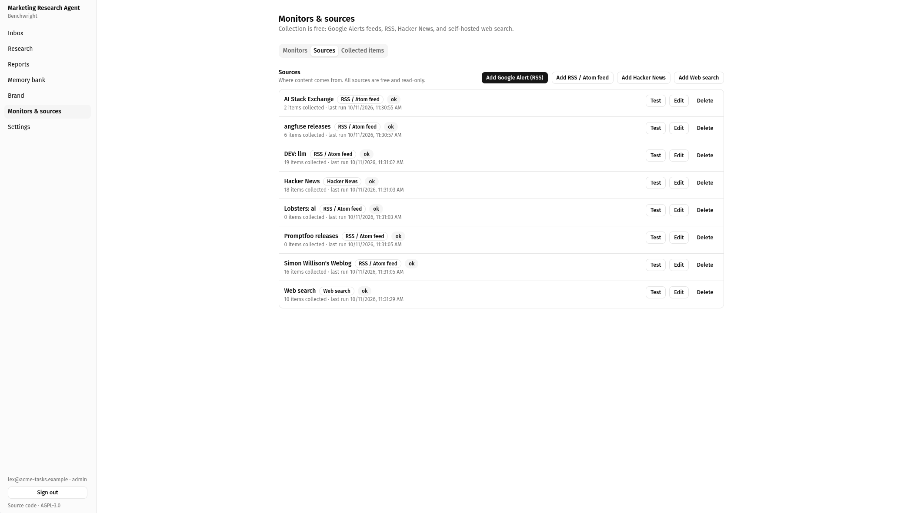
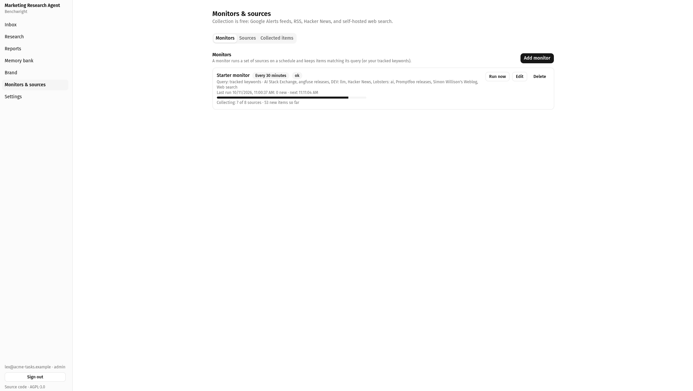
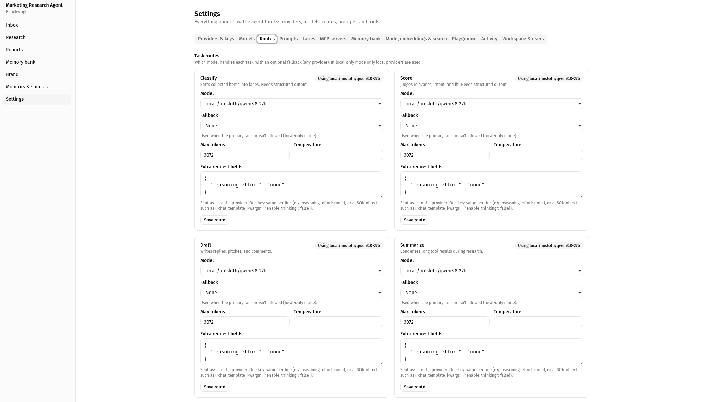
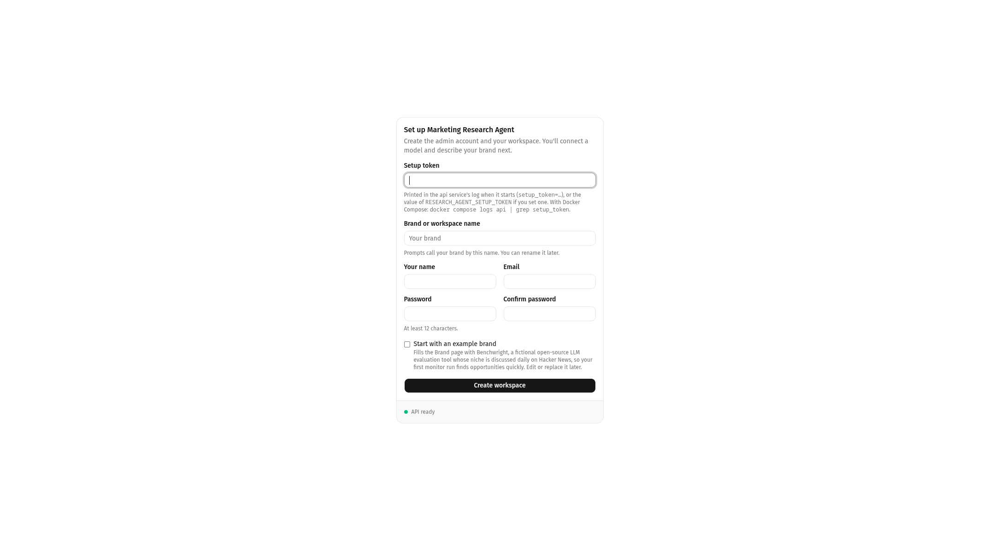

# Marketing Research Agent

[](https://github.com/BiodigitalJaz/marketing-research-agent/actions/workflows/ci.yml)
[](LICENSE)
[](go.mod)

**A self-hosted research assistant for marketing teams.** It watches the conversations and articles that matter to your brand, ranks the ones worth a response, drafts replies for a person to review, and answers research questions with cited sources.

> **Read-only by design.** The agent never posts, comments, or messages anywhere. It finds openings and prepares drafts; people decide, edit, and post. CI enforces this.

It runs on your infrastructure with hosted models (Anthropic, OpenAI), local ones (Ollama, LM Studio, llama.cpp, vLLM, or any OpenAI-compatible server), or both.



## How it works



## Screenshots

The screenshots use Benchwright, a fictional brand included as an [example brand pack](examples/brand-packs/benchwright.yaml), collecting real public posts.

<table>
  <tr>
    <td width="50%"><a href="docs/images/opportunity.png"></a><br><sub><b>Opportunity.</b> A draft in the brand's voice, labelled for review, next to why it surfaced.</sub></td>
    <td width="50%"><a href="docs/images/brand.png"></a><br><sub><b>Brand.</b> Voice, banned claims, and targeting that steer scoring and drafts.</sub></td>
  </tr>
  <tr>
    <td width="50%"><a href="docs/images/research.png"></a><br><sub><b>Research.</b> Ask a question, or run deep research over collected items and the web.</sub></td>
    <td width="50%"><a href="docs/images/research-results.png"></a><br><sub><b>Report.</b> Plans, gathers, verifies, and writes a cited report; export to Markdown.</sub></td>
  </tr>
  <tr>
    <td width="50%"><a href="docs/images/monitor-sources.png"></a><br><sub><b>Sources.</b> Free, read-only sources: RSS and Google Alerts, Hacker News, web search.</sub></td>
    <td width="50%"><a href="docs/images/monitor-progress.png"></a><br><sub><b>Monitors.</b> Scheduled collection with live progress.</sub></td>
  </tr>
  <tr>
    <td width="50%"><a href="docs/images/routes.png"></a><br><sub><b>Routes.</b> A model, fallback, and parameters for each task; here, all local.</sub></td>
    <td width="50%"><a href="docs/images/setup.png"></a><br><sub><b>Setup.</b> First run in the browser, optionally with the example brand.</sub></td>
  </tr>
</table>

## Features

**Find opportunities**
- Monitors collect from Google Alerts and other RSS/Atom feeds, Hacker News, and web search (a bundled SearXNG, or Brave or Google Programmable Search) on schedules you set.
- Items are filtered by your keywords, de-duplicated, then classified and scored by a model into three lanes: inbound questions you can answer, media and speaking opportunities, and thought-leadership discussions.
- Every score breaks down into relevance, intent, fit, recency, and reach, with a one-sentence explanation and flags such as "outside target region" or "reply may need a claim we don't make".

**Respond well**
- A daily inbox features the best opportunities per lane, with keyboard triage, dismissal reasons, and outcome tracking.
- Drafts (replies, pitches, comments) follow your brand's voice and are checked against the claims you never make and each community's rules: links removed where they aren't allowed, affiliation disclosed where it's required. Every draft is labelled for review.

**Research**
- Ask questions in chat or run deep research that plans, gathers, verifies, and writes a report with charts and numbered citations; export to Markdown.
- Sources include everything collected, the public web (fetched politely, with SSRF protection), your brand profile, read-only MCP tools, and, optionally, your own product docs synced from GitHub with a generated memory bank.

**Stay in control**
- Brand knowledge, prompts (versioned), models, routes, and fallbacks are all editable in the UI. Describe a brand in one YAML file and import or export it.
- Local-only mode keeps every model call on your hardware. API keys entered in the UI are encrypted at rest and never shown again.
- First-run setup in the browser, a Getting started checklist, and roles for viewers, editors, and admins.

## Requirements

| | Docker Compose (one machine) | Kubernetes |
|---|---|---|
| **Runtime** | Docker Engine with the Compose plugin (v2) | Kubernetes (tested on 1.33) with kustomize |
| **Database** | Included (PostgreSQL 17 with pgvector) | PostgreSQL 17 with the `vector`, `pg_trgm`, `citext`, and `pgcrypto` extensions |
| **Machine** | About 2 CPU cores and 4 GB of memory for the stack, plus disk for collected items | Requests total about 1 CPU and 1.3 GB; see [sizing](docs/deployment.md#sizing) |
| **Language model** | An Anthropic or OpenAI API key, or an OpenAI-compatible server (Ollama, LM Studio, llama.cpp, vLLM) | Same |
| **Embeddings** | Strongly recommended: any OpenAI-compatible `/v1/embeddings` endpoint | Same |
| **Network** | Outbound internet for collection, search, and hosted models; users reach only the web UI | Same; see [network](docs/deployment.md#network) |

A local model needs a GPU for real use: about 10–12 GB of GPU memory for a 14B model, 20–24 GB for 27B–32B. See [Choosing models](docs/models.md).

## Quick start

This path uses Docker Compose on one machine.

```sh
git clone https://github.com/BiodigitalJaz/marketing-research-agent.git
cd marketing-research-agent
cp .env.example .env                        # then set RESEARCH_AGENT_SECRETS_KEY (see below)
make dev                                    # PostgreSQL, migrations, api, worker, web, SearXNG
docker compose logs -f api | grep -m1 setup_token   # one-time setup token, once the api has started
```

Set `RESEARCH_AGENT_SECRETS_KEY` in `.env` (`openssl rand -base64 32`) before the first start if you want to enter API keys in the UI; they are stored encrypted with it. Without it, put keys in `.env` as `ANTHROPIC_API_KEY` or `OPENAI_API_KEY` instead.

Open http://localhost:3000. Setup creates your admin account and workspace (optionally with a fictional example brand), then **Getting started** walks you through connecting a model, embeddings, search, your brand, and your first sources. See [Getting started](docs/getting-started.md).

### Choosing models

| Option | Recommended models | Notes |
|---|---|---|
| Hosted | Claude Sonnet 5.5 for drafts and research, Claude Haiku 4.5 for classify, score, and summarize (the seeded defaults) | Add an Anthropic or OpenAI key in **Settings → Providers & keys**. No hardware needed. |
| Local on a GPU | A 14B–32B instruction model with tool calling and JSON-schema output; tested with Qwen3.8 27B on LM Studio for every task | Run the server on the host and set `LOCAL_LLM_BASE_URL` in `.env` before first-run setup (for example `http://host.docker.internal:1234/v1`), or edit the `local` provider in **Settings → Providers & keys** later. Turn thinking off (`reasoning_effort: none`) and use at least 8k context. |
| Local on CPU | A small model | `docker compose --profile ollama up -d`, then pull a model into the `ollama` container. Fine for trying it out; slow for real use. |

Each task (classify, score, draft, research, summarize) can use a different model, with a fallback; a common setup runs the high-volume tasks locally and research on a hosted model. [Choosing models](docs/models.md) covers what each task needs, hardware, and the settings that matter for local models.

## Deploy to Kubernetes

Kustomize manifests with NodePort and Ingress examples are in [`deploy/k8s`](deploy/k8s/README.md). Deploys are planned, applied, and verified in three steps:

```sh
make deploy-plan TAG=sha-<commit>    # render, check images, server dry run, diff (changes nothing)
make deploy TAG=sha-<commit>         # apply exactly that plan
make deploy-verify TAG=sha-<commit>  # images, pods, migrations, health
```

The [runbook](docs/runbook.md) covers fresh installs, upgrades, backups, rollback, and troubleshooting, step by step, for people and AI agents alike.

## Documentation

| Using it | Running it |
|---|---|
| [Getting started](docs/getting-started.md) | [Deployment](docs/deployment.md): requirements, sizing, network |
| [Using the inbox](docs/inbox.md) | [Runbook](docs/runbook.md): install, upgrade, backup, rollback |
| [Research and reports](docs/research.md) | [Configuration](docs/configuration.md): every setting |
| [The Brand page](docs/brand.md) and [brand packs](docs/brand-packs.md) | [Architecture](docs/architecture.md): how it fits together |
| [Monitors and sources](docs/sources.md) | [Security policy](SECURITY.md) |
| [Settings](docs/settings.md) | [Testing and tested configurations](docs/testing.md) |
| | [Changelog](CHANGELOG.md) |
| [The memory bank](docs/memory-bank.md) | [Choosing models](docs/models.md): tasks, hardware, settings |

## Development

Go (version in `go.mod`), Node 22+, pnpm 9, and Docker. `make tools` installs the Go tooling.

| Command | What it does |
|---|---|
| `make dev` / `make down` | Start or stop the Compose stack |
| `make test` | Unit and integration tests (PostgreSQL via testcontainers) |
| `make lint` | go vet, staticcheck, golangci-lint, web lint, and the no-posting check |
| `make check-licenses` | Fail on dependency licenses incompatible with AGPL-3.0 |
| `make sqlc` / `make api-client` | Regenerate query code or the typed web API client |

The backend is Go (gin, pgx with sqlc, River for background jobs) on PostgreSQL with pgvector; the frontend is Next.js with TanStack Query. Code lives in `cmd/` (api, worker, migrate, seed), `internal/`, `migrations/`, and `web/`; see [Architecture](docs/architecture.md).

## Project status

Version 0.1.0 is the first public release. The full workflow above works end to end, but expect rough edges and breaking changes before 1.0; see [known limitations](docs/deployment.md#known-limitations). Planned next: dashboards and analytics, an audit-log viewer, Prometheus metrics, an evaluation harness for prompts and models, browser end-to-end tests, and configuring the web image's API address at runtime. Ideas and bug reports are welcome in [issues](https://github.com/BiodigitalJaz/marketing-research-agent/issues).

## Contributing

Contributions are welcome. Read [CONTRIBUTING.md](CONTRIBUTING.md) for the ground rules, development setup, and conventions, and follow the [Code of Conduct](CODE_OF_CONDUCT.md). Report security issues privately as described in [SECURITY.md](SECURITY.md).

## License

[GNU Affero General Public License v3.0 only](LICENSE). If you run a modified version for others over a network, offer them its source; the app's sidebar links to the source code, and `web/src/lib/app.ts` holds that link.
