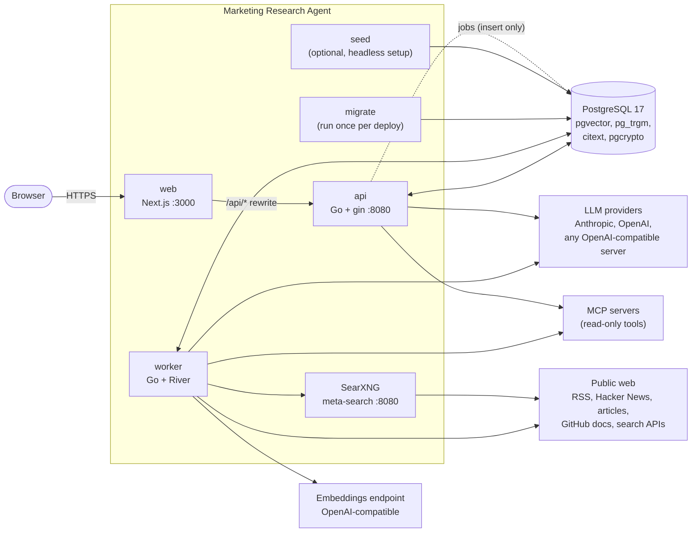
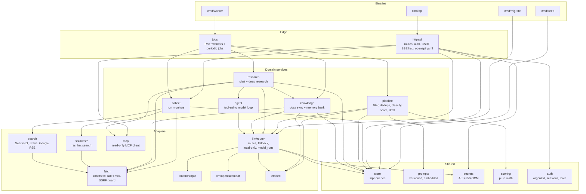
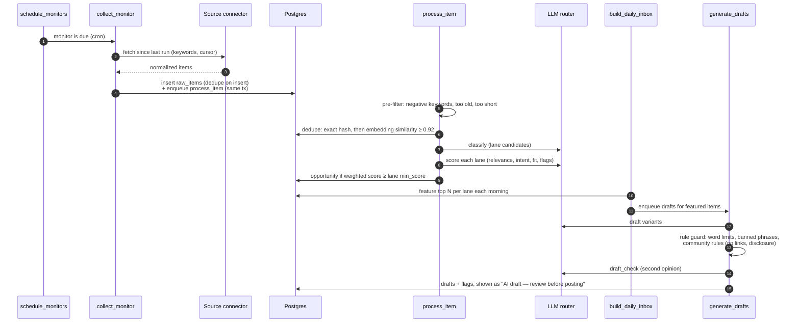
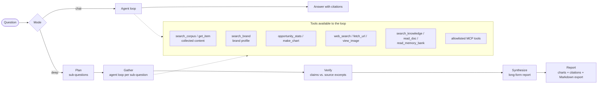
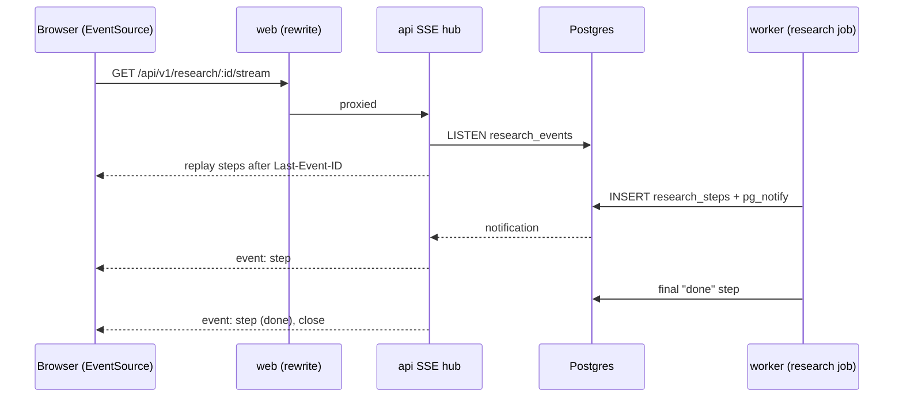
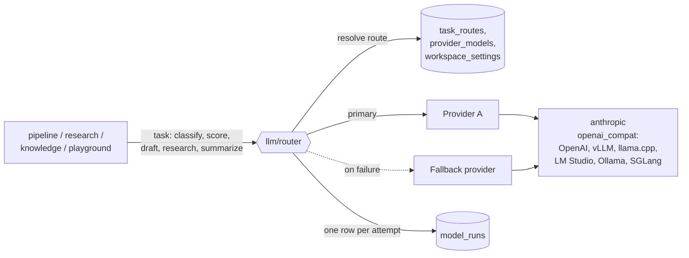
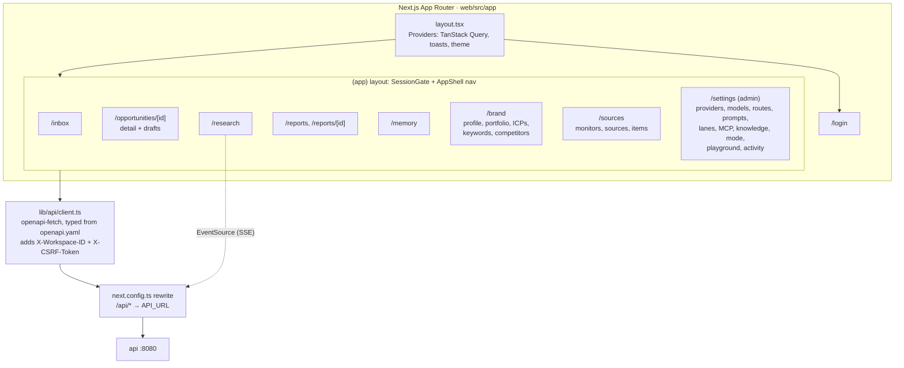
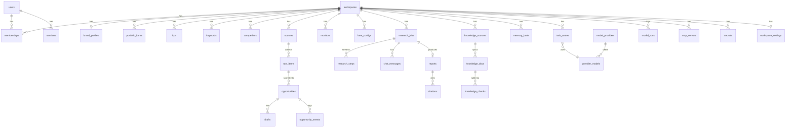

# Architecture

Marketing Research Agent is a self-hosted marketing research tool. It collects public conversations and articles, scores them as opportunities for a brand, drafts replies for a human to review, and answers research questions with cited sources. It is **read-only toward the outside world**: it never posts, comments, or sends messages anywhere.

This document describes how the pieces fit together. For running it, see [deployment.md](deployment.md); for every setting, see [configuration.md](configuration.md).

- [System overview](#system-overview)
- [Backend](#backend)
- [Collection pipeline](#collection-pipeline)
- [Research](#research)
- [LLM layer](#llm-layer)
- [Frontend](#frontend)
- [Security model](#security-model)
- [Data model](#data-model)

## System overview

Four Go binaries share one PostgreSQL database. The web app is a Next.js server that proxies `/api/*` to the API, so browsers only ever talk to one origin.

| Component | Role |
|---|---|
| **web** | Next.js App Router UI. Client-side rendered pages; all data comes from the API through a same-origin rewrite. |
| **api** | REST + Server-Sent Events. Auth, CSRF, roles, all CRUD, and a few synchronous outbound calls (provider test, model discovery, source dry-run, playground). Enqueues background work; never runs it. |
| **worker** | Runs every background job on [River](https://riverqueue.com) (a Postgres-backed queue): collection, scoring, drafting, research, knowledge sync, periodic housekeeping. |
| **migrate** | Applies goose migrations and River's schema, then exits. Runs as an init container before the API. |
| **seed** | Optional idempotent bootstrap for headless installs. |
| **SearXNG** | Self-hosted meta-search, restricted to engines whose terms allow automated use. Default web search backend; Brave and Google Programmable Search are optional paid alternatives. |
| **PostgreSQL** | The only stateful dependency: app data, vectors (pgvector), the job queue, and research event fan-out (`LISTEN/NOTIFY`). |

## Backend

### Binaries and packages

All binaries start through `internal/app.Bootstrap` (flags, config, logger) and open a pgx pool with `internal/db`.

Rules that keep this shape (enforced by review and CI):

- Only `internal/llm/anthropic` and `internal/llm/openaicompat` import vendor LLM SDKs. Everything else uses `internal/llm` types through the router.
- URLs that come from collected content are fetched only through `internal/fetch`.
- No package under `sources`, `fetch`, `search`, `collect`, `agent`, `research`, or `knowledge` issues an HTTP write (`scripts/check_no_posting.sh`). There are no exceptions.
- SQL lives in `internal/store/queries/*.sql` and is compiled by sqlc. Every workspace query filters by `workspace_id`.

### Background jobs

| Job | Queue | Trigger | What it does |
|---|---|---|---|
| `schedule_monitors` | default | every minute | Enqueues `collect_monitor` for monitors whose cron is due |
| `collect_monitor` | default | scheduler, or **Run now** | Fetches every source in a monitor; inserts new items and enqueues `process_item` in the same transaction |
| `process_item` | pipeline | per new item | Pre-filter → dedupe → classify → score → opportunity |
| `build_daily_inbox` | default | hourly (acts once after 06:00 local) | Features the top opportunities per lane; enqueues drafts for them |
| `expire_opportunities` | default | hourly | Expires stale opportunities, wakes snoozed ones |
| `generate_drafts` | pipeline | on open, or eagerly for featured items | Writes draft variants, runs the rule guard and model check |
| `embed_entity` | default | on brand portfolio / ICP writes | Embeds brand entities for similarity scoring |
| `research` | research | on question / follow-up | Runs a chat or deep research job |
| `sync_knowledge` | research | on demand | Pulls changed docs from a GitHub repo, splits and embeds them |
| `build_memory_bank` | research | after a sync with changes, or on demand | Summarizes docs into the memory bank, in resumable 12-minute slices |
| `purge_sessions` | default | every 6 h | Deletes expired sessions |
| `rotate_secrets` | default | daily | Re-encrypts secrets under the current master key |
| `retention_sweep` | default | daily | Deletes collected items past `retention.raw_items_days`, keeping those behind an opportunity someone saved, snoozed, or acted on and those a report cites |

Queue concurrency: `default` = `worker.max_workers` (10), `pipeline` = `worker.pipeline_workers` (2), `research` = 2. Stuck jobs are rescued after 50 minutes. Knowledge sync and memory bank builds never overlap within a workspace (Postgres advisory lock).

## Collection pipeline

A **monitor** is a schedule plus a set of **sources** plus the **lanes** it feeds. Each lane is a kind of opportunity with its own scoring weights, freshness window, and daily quota:

| Lane | Typical opportunity | Draft kind |
|---|---|---|
| inbound | Someone asking a question the brand can answer | reply |
| media | A journalist or publication looking for sources | pitch |
| thought_leadership | A discussion where a perspective adds value | comment |

**Sources.** Connectors implement one interface (`internal/sources`), validate their own config, and return normalized items plus a cursor:

| Kind | Reads |
|---|---|
| `rss` | Any RSS/Atom feed, including Google Alerts (redirect links unwrapped). Optional full-text fetch. |
| `hn` | Hacker News lists via the official Firebase API |
| `search` | The workspace search backend (SearXNG, Brave, or Google PSE), rotating through tracked keywords; paid backends respect a monthly budget |

**Scoring.** The final score is a weighted sum of factors in `[0,1]`: relevance (LLM judgment blended with embedding similarity to the brand), intent, fit, recency (exponential decay over the lane's freshness window), reach (from engagement metrics), and deadline (media lane). The math is in `internal/scoring` as pure functions. Lane weights are editable in Settings.

**Brand context.** Every classify, score, and draft prompt receives the workspace's brand profile: offering, value propositions, tone rules (do / don't / banned phrases), targeting (audiences to prioritize and avoid, geography, venues the brand won't post in), keywords, competitors, ICPs, and portfolio. Changing the brand changes behavior without code changes.

## Research

Research answers questions with numbered citations. There are two modes:

- **Chat**: one agent loop with tools; follow-up questions continue the conversation.
- **Deep**: plan → gather (one agent loop per sub-question) → verify (each key claim against the passage of its cited sources that best matches it; the notebook keeps the text every tool showed for each source) → synthesize into a report with charts, listing supported and unsupported claims.

The **agent loop** (`internal/agent`) is provider-agnostic:

- A tool registry filtered by policy: the route's tool allowlist, the "use the web" toggle, and model capabilities (vision).
- A per-run notebook that numbers every source a tool returns; the final answer may cite only those numbers.
- Limits on steps, wall-clock time, and tokens. Defaults are chat 14 steps / 8 min, deep 40 steps / 15 min (plus up to 10 min to verify and write). A route can override max steps and the token budget; its time limit applies to deep research only, capped at 30 minutes.
- A repeated-call guard (an identical tool call returns a notice instead of re-running).
- Context compaction: older tool results are summarized at 60% of the model's context window, then trimmed if needed. This lets small-context local models finish long runs.

**Live progress.** Each step is written to `research_steps` and broadcast with `pg_notify`. The API's SSE hub `LISTEN`s and streams steps to the browser, with `Last-Event-ID` replay so reconnects resume where they left off.

**Knowledge and memory bank.** A workspace can sync Markdown docs from a GitHub repository (read-only, on demand). Docs are split at headings and embedded for `search_knowledge`. A memory bank, modeled on Cline's, condenses them into six core files (`projectbrief`, `productContext`, `systemPatterns`, `techContext`, `activeContext`, `progress`) that research reads first for questions about the brand's own product. Only research uses knowledge; drafting never does, so internal details don't leak into public replies.

## LLM layer

- **Providers** are configured in Settings: kind, base URL, API key (encrypted secret or env var name), local flag, max concurrent calls, retries.
- **Models** declare capabilities: tools, structured output (JSON Schema), vision, thinking style, context window, max output. Capabilities are used to validate configuration and gate the vision tool. Hosted and local models go through the same code paths.
- **Routes** map each task to a primary model, an optional fallback, parameters, tool allowlist, MCP servers, and agent limits.
- **Prompts** are versioned. Defaults ship embedded in the binary; admins create new versions and activate them per workspace.
- **Structured outputs** always have a JSON Schema and are validated before use.
- **Local-only mode** removes hosted providers from every route and refuses hosted embeddings. Collection and web search keep running.
- **model_runs** logs every call (task, model, tokens, latency, cost, status, prompt version), never the prompt text.

## Frontend

- **Rendering:** pages are client components; data is fetched with TanStack Query through a typed client generated from `internal/httpapi/openapi.yaml` (`pnpm gen:api`, checked in CI).
- **Session:** `SessionGate` calls `/auth/me`; a 401 redirects to `/login`. The response carries the CSRF token and the user's workspaces. There is no Next.js middleware: the API enforces all authorization.
- **One origin:** the browser calls `/api/v1/*` on the web origin and Next rewrites to the API, so cookies are same-origin and the API need not be exposed. `API_URL` is fixed at **build time**.
- **Streaming:** research progress uses `EventSource`; the playground reads a streamed `fetch` response.
- **UI kit:** Tailwind, shadcn/ui on Base UI, Recharts for charts, react-markdown for answers and reports. Every AI-generated text carries a review label.

## Security model

| Concern | Mechanism |
|---|---|
| No outbound writes | Connectors are GET-only; CI script rejects HTTP write verbs in collection and research packages; MCP tools must be allowlisted by an admin **and** annotated read-only |
| Untrusted content | Collected text, fetched pages, and tool/MCP results are wrapped in `<external_content>` delimiters in prompts and can never change which tools are available |
| SSRF | `internal/fetch` resolves and rejects private, loopback, link-local, and reserved addresses at dial time; respects robots.txt; rate-limits per host; caps body size |
| Passwords | argon2id (OWASP parameters); login throttled per email |
| Sessions | Random 256-bit token in an HttpOnly cookie; only its SHA-256 is stored; 14-day expiry; `__Host-` + Secure cookies when served over HTTPS |
| CSRF | Double-submit token on every state-changing request; SameSite=Lax |
| Roles | viewer (read, log events) < editor (brand, monitors, triage, drafts, research) < admin (sources, all settings) |
| Secrets | API keys entered in the UI are stored only as AES-256-GCM ciphertext bound to their id and workspace; write-only through the API; master key from env, with rotation |
| Tenancy | Every workspace-data query filters by `workspace_id` |
| Audit | Logins, brand and source changes, settings, secrets, and research are written to `audit_log` |

## Data model

Also: `embeddings` (one table for every vector: raw items, portfolio, ICPs, knowledge chunks, keyed by entity and model), `prompts` (global defaults plus workspace versions), `search_usage` (paid search budget), `audit_log`, and River's `river_*` tables.

Similarity search is exact: queries filter by workspace and entity type (an ordinary index) and compare vectors with pgvector's cosine distance, so any embedding model and dimension works and results are never approximate. That stays fast into the tens of thousands of vectors per workspace, which the retention sweep keeps it under for most installs. A large install can add an HNSW index for its model's dimension in a migration.
