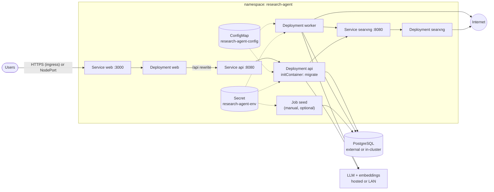
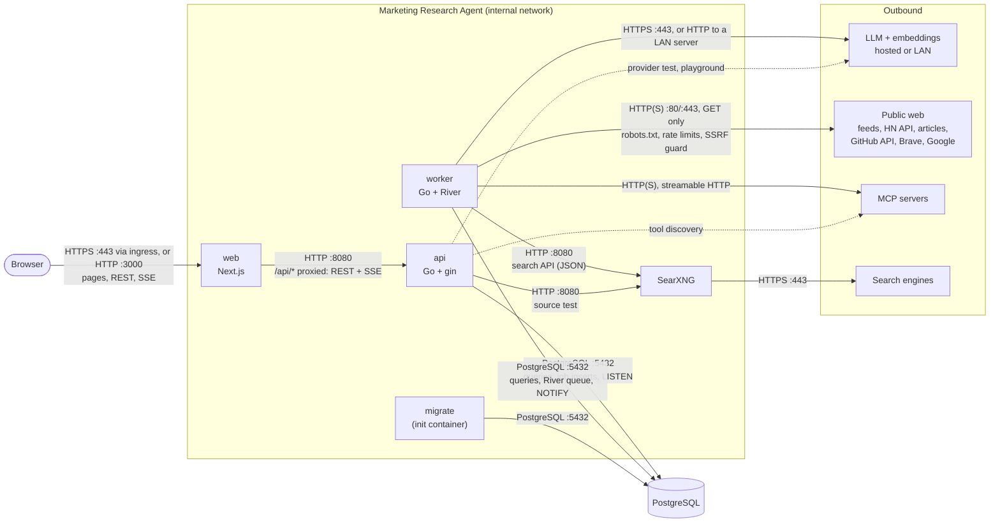

# Deployment

This page lists what Marketing Research Agent needs to run and how to deploy it with Docker Compose or Kubernetes. See [architecture.md](architecture.md) for how the parts fit together and [configuration.md](configuration.md) for every setting.

## Requirements at a glance

| Need | Required? | Notes |
|---|---|---|
| PostgreSQL 17 | **Yes** | Extensions `vector` (pgvector 0.8 tested), `pg_trgm`, `citext`, `pgcrypto` |
| Container runtime | **Yes** | Docker Compose for one machine; Kubernetes (tested on 1.33) for a cluster |
| An LLM | **Yes** | Any of: Anthropic API, OpenAI API, or an OpenAI-compatible server (Ollama, LM Studio, llama.cpp, vLLM, SGLang). Needs tool calling and JSON-schema structured output. |
| An embeddings endpoint | Strongly recommended | OpenAI-compatible `/v1/embeddings`. Without it, near-duplicate detection, brand similarity, portfolio matching, and semantic search are skipped. |
| Secrets master key | Strongly recommended | 32 random bytes, base64. Without it, API keys can't be entered in the UI and must be supplied as environment variables. |
| Web search | Optional | SearXNG (bundled, free) or Brave / Google Programmable Search (paid, budgeted) |
| Outbound internet | Yes, for collection | See [Network](#network) |
| TLS termination | Recommended | Reverse proxy or ingress in front of the web service |

### Sizing

The app itself is light. The LLM is where the compute goes.

| Component | CPU request | Memory request / limit |
|---|---|---|
| api | 100m | 128 Mi / 256 Mi |
| worker | 250m | 256 Mi / 512 Mi |
| web | 100m | 192 Mi / 384 Mi |
| SearXNG | 100m | 192 Mi / 512 Mi |
| PostgreSQL | 250m+ | 512 Mi+; disk grows with collected items (text + 768-float vectors) |

**LLM guidance.** Every task (classify, score, draft, research, summarize) can be routed to a different model; [Choosing models](models.md) has the details.

- **Hosted models** need no hardware. Research is the token-heavy task; everything else is short.
- **Local models:** a 14B–32B instruction model with reliable tool calling and JSON-schema output handles all tasks. Use at least 8k context; 16k–32k makes research noticeably better. On a single 16–24 GB GPU, set the provider's *max simultaneous calls* to 1 and keep `worker.pipeline_workers` at 2 or lower.
- **Embeddings:** a small model such as `nomic-embed-text` (768 dimensions) runs fine on CPU. Any model and dimension works; search is exact (see [architecture.md](architecture.md#data-model)).

## Docker Compose (single machine)

`docker-compose.yml` runs postgres (pgvector image), migrate, api, worker, web, SearXNG, and optionally Ollama.

```bash
cp .env.example .env
# Edit .env:
#   RESEARCH_AGENT_SECRETS_KEY  openssl rand -base64 32
#   RESEARCH_AGENT_ADMIN_EMAIL / RESEARCH_AGENT_ADMIN_PASSWORD   (only for headless seeding)
#   ANTHROPIC_API_KEY / OPENAI_API_KEY             optional
#   LOCAL_LLM_BASE_URL   optional, e.g. http://host.docker.internal:11434/v1

make dev                                    # build and start the stack
docker compose logs -f api | grep -m1 setup_token   # one-time first-run token
open http://localhost:3000                  # setup page: admin, workspace, then the checklist
```

To run a local model in the stack, add `--profile ollama` and pull a model into the `ollama` container. For a GPU, run the model server on the host instead and point `LOCAL_LLM_BASE_URL` at it before first-run setup (it fills in the `local` provider when the workspace is created; change it later in Settings).

| Service | Port on host | Purpose |
|---|---|---|
| web | 3000 | The UI; the only port users need |
| api | 8080 | Direct API access (debugging) |
| postgres | 5432 | Development access; don't publish it on shared hosts |
| searxng | 8888 | Search UI for checking engines |
| ollama | 11434 | Only with `--profile ollama` |

The compose file ships **insecure development defaults** (database password, SearXNG secret). Change them before exposing the host to a network.

## Kubernetes

Manifests are a kustomize base plus overlays in `deploy/k8s`.



### What's in the base

| Resource | Details |
|---|---|
| `Deployment/api` | 1 replica. Init container runs `migrate` (idempotent, advisory-locked). Readiness `GET /ready` (DB ping), liveness `GET /health`. Read-only root filesystem, non-root, all capabilities dropped. |
| `Deployment/worker` | 1 replica, 45 s termination grace so jobs drain. No HTTP endpoint. |
| `Deployment/web` | 1 replica, Next.js standalone. emptyDir for `.next/cache`. Probes on `/login`. |
| `Deployment/searxng` | Digest-pinned image, engine allowlist in `searxng-settings.yml`, read-only root. |
| `Service` api, web, searxng | ClusterIP. Expose only `web`. |
| `ConfigMap/research-agent-config` | Generated from `base/config.yaml` (hash suffix, so edits roll the pods) |
| `jobs/seed.yaml` | Optional one-shot Job, not part of the kustomization |

Two example overlays are included: `example-nodeport` (web on a NodePort) and `example-ingress` (an Ingress with TLS, with SSE-friendly annotations). For your own cluster, keep an overlay outside the repo that sets your image registry and tags, your `config.yaml`, and how the web UI is exposed; see [deploy/k8s/README.md](../deploy/k8s/README.md).

### Secrets to create

Created out of band and never committed. The [runbook](runbook.md#2-namespace-and-secrets) has the exact commands, which keep values off the command line.

| Secret | Keys |
|---|---|
| `research-agent-env` | **Required:** `RESEARCH_AGENT_DATABASE_URL`, `RESEARCH_AGENT_SECRETS_KEY` (base64 of 32 random bytes). **Recommended:** `RESEARCH_AGENT_SERVER_BASE_URL`. **Optional:** `LOCAL_LLM_BASE_URL`, `ANTHROPIC_API_KEY`, `OPENAI_API_KEY`, `BRAVE_API_KEY`, a GitHub token for knowledge sync, `RESEARCH_AGENT_SECRETS_KEY_PREVIOUS` (rotation), `RESEARCH_AGENT_SETUP_TOKEN` |
| `searxng-secret` | `SEARXNG_SECRET` |
| `research-agent-admin` | `RESEARCH_AGENT_ADMIN_EMAIL`, `RESEARCH_AGENT_ADMIN_PASSWORD`: only for the headless seed Job |
| `ghcr-secret` (or your own) | A `kubernetes.io/dockerconfigjson` pull secret, only for a private registry |

Back up `RESEARCH_AGENT_SECRETS_KEY`. Without it, stored API keys can't be decrypted.

### Deploy

Follow the [runbook](runbook.md): `make deploy-plan` (renders with pinned images, checks they exist, dry-runs on the server, shows `kubectl diff`), then `make deploy` (applies exactly that plan), then `make deploy-verify`. The runbook also covers backups, upgrades, and rollback.

Images: CI builds `ghcr.io/<owner>/<repo>-{api,worker,migrate,web}` on every push to `main` and tags them `main` and `sha-<commit>`. Pin `sha-` tags in your overlay so a rollout is reproducible.

`web` bakes the API address in at build time (`API_URL`, default `http://api:8080`). If your API Service has another name, rebuild the web image with `--build-arg API_URL=...`.

### First run

Set `RESEARCH_AGENT_SERVER_BASE_URL` in `research-agent-env` to the URL people open (for example `https://research.example.com`). Cookies are `Secure` when it starts with https, and the setup message in the log shows the right address.

On first start with an empty database, the api logs a one-time setup token (`kubectl -n research-agent logs deploy/api | grep setup_token`). Open the web service; it redirects to `/setup`. With several api replicas, each start replaces the token, so use the most recent log, or set `RESEARCH_AGENT_SETUP_TOKEN` in `research-agent-env` to choose it. See [getting-started.md](getting-started.md). The seed Job is an alternative for unattended installs.

## PostgreSQL

- **Version:** 17 (CI and the Compose stack use 17 with pgvector 0.8). Older versions are untested.
- **Extensions:** `vector`, `pg_trgm`, `citext`, `pgcrypto`. The first migration runs `CREATE EXTENSION IF NOT EXISTS`. `vector` isn't a trusted extension, so if the app's role isn't a superuser, create the extensions once as a superuser:

  ```sql
  CREATE ROLE research_agent LOGIN PASSWORD '...';
  CREATE DATABASE research_agent OWNER research_agent;
  \c research_agent
  CREATE EXTENSION vector; CREATE EXTENSION pg_trgm;
  CREATE EXTENSION citext; CREATE EXTENSION pgcrypto;
  ```

- **Connection pooling:** the app uses session features (`LISTEN/NOTIFY` for live research progress, advisory locks for migrations and knowledge sync). Connect directly or through a **session-mode** pooler. Transaction-mode PgBouncer won't work.
- **Pool size:** pgx defaults (max of 4 or the CPU count per process). Tune with `?pool_max_conns=N` in the URL.
- **Backups:** everything (data, queue, encrypted secrets) is in this database. Back it up with your usual tooling (`pg_dump` CronJob, operator snapshots, etc.).
- **Retention:** collected items expire after `retention.raw_items_days` (default 90). A daily job deletes expired items, except those behind an opportunity someone saved, snoozed, or acted on, and those a report cites. Disk use levels off at roughly that many days of collection.

## Network

Browsers reach only the web service. Everything else is internal, apart from the worker's (and occasionally the API's) outbound calls, all of which are read-only requests.



| From | To | Port | Protocol | Purpose |
|---|---|---|---|---|
| Browser | web | 3000 (or 443 through an ingress) | HTTP(S) | UI, and the API through the same origin. Research progress streams over Server-Sent Events. |
| web | api | 8080 | HTTP | Next.js proxies `/api/*`, including SSE streams. Set at build time by `API_URL`. |
| api, worker, migrate | PostgreSQL | 5432 | PostgreSQL wire protocol (TLS optional, per `sslmode` in the URL) | App data, vectors, the River job queue, and research event fan-out with `LISTEN`/`NOTIFY`. |
| worker, api | SearXNG | 8080 (Compose publishes it on the host as 8888) | HTTP | Web search (JSON API). |
| worker, api | LLM and embeddings | 443 for hosted APIs; your server's port on the LAN (LM Studio 1234, Ollama 11434, vLLM 8000) | HTTPS or HTTP | Anthropic API, or OpenAI-compatible `/v1/chat/completions` and `/v1/embeddings`. |
| worker | Public web | 80 / 443 | HTTP(S), GET only | Feeds, the Hacker News API, article and `robots.txt` fetches, GitHub docs, Brave or Google search. |
| worker, api | MCP servers | The server's URL | Streamable HTTP | Read-only tools that an admin has allowlisted. |
| SearXNG | Search engines | 443 | HTTPS | Wikipedia, arXiv, Stack Exchange, and the other enabled engines. |

**Inbound:** only the web service (port 3000) needs to be reachable by users. The API, SearXNG, and Postgres stay internal.

**Outbound** from the worker (and the API, which tests providers and sources):

| Destination | When |
|---|---|
| PostgreSQL | Always |
| LLM and embeddings endpoints | Always. Hosted (`api.anthropic.com`, `api.openai.com`) and/or your local server |
| `hacker-news.firebaseio.com` | Hacker News sources |
| RSS feed hosts you configure (e.g. `www.google.com` for Google Alerts) | RSS sources |
| SearXNG (internal), `api.search.brave.com`, `www.googleapis.com` | Web search |
| **Any public HTTP(S) host** | Full-text article fetch, research `fetch_url`, each host's `robots.txt` |
| `api.github.com` | Knowledge (memory bank) sync |
| MCP server URLs | If MCP servers are configured |

SearXNG itself needs outbound access to its enabled engines (Wikipedia, arXiv, Crossref, OpenAlex, PubMed, Semantic Scholar, Stack Exchange, GitHub).

**Proxies:** the content fetcher (collectors, search backends, GitHub) intentionally ignores `HTTP(S)_PROXY` so the SSRF guard sees the real destination IP. If egress must go through a proxy, make it transparent for the worker. The LLM clients do honor proxy variables.

**Private addresses:** the fetcher refuses private and loopback IPs for URLs that come from collected content. LLM, embeddings, SearXNG, and MCP endpoints are admin-configured and may be on the LAN.

## Operations

| Task | How |
|---|---|
| Health | `GET /health` (process up), `GET /ready` (database reachable), on the API |
| Logs | JSON to stdout (`log.format: text` for local dev). Every request has an `X-Request-ID`. |
| Model usage and cost | Settings → Activity (`model_runs`) |
| Job queue | River tables in Postgres (`river_job`). Jobs stuck over 50 minutes are rescued automatically. |
| Rotate the secrets key | Set the new key as `RESEARCH_AGENT_SECRETS_KEY` and the old one as `RESEARCH_AGENT_SECRETS_KEY_PREVIOUS`, restart, and the daily `rotate_secrets` job re-encrypts. Remove the previous key once it has run. |
| Upgrade | Roll out new images. Migrations run in the API's init container under an advisory lock. |
| Scale | Run one worker replica per LLM capacity. Login throttling and per-provider concurrency limits are per process, so multiple API or worker replicas each get their own limits. |

## Known limitations

- Deep research's claim check is a model's judgment on short excerpts of each cited source: it can miss support elsewhere in a long page or accept a loose match. Chat answers have no claim check. Review citations before relying on a report.
- The worker has no health endpoint or probe.
- MCP servers using the `stdio` transport need an interpreter in the worker image. The default distroless image has none, so use `streamable_http` servers.
- `API_URL` for the web image is fixed at build time.
